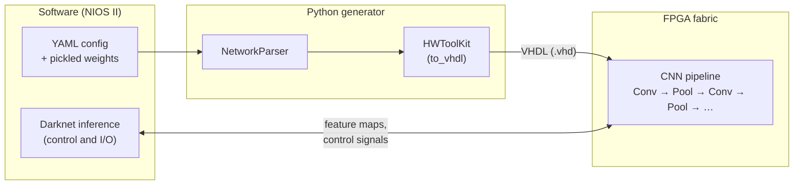
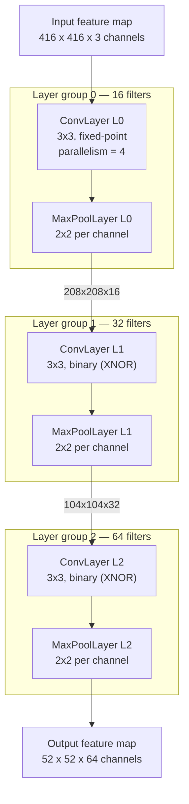
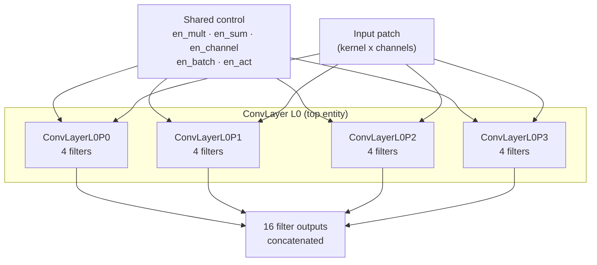
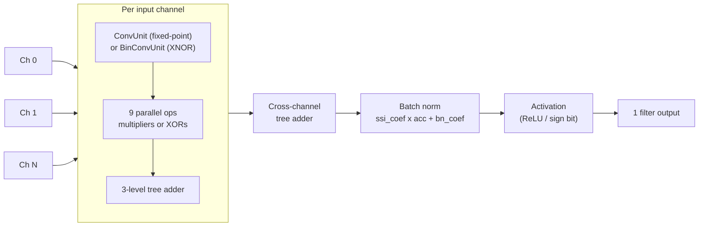
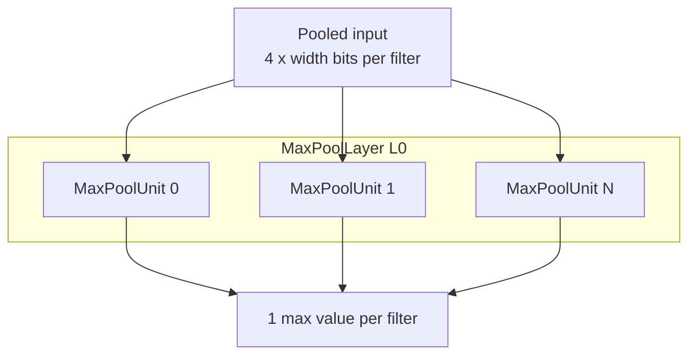

<p align="center">

</p>

*yolowell* is a Python library that generates VHDL for convolutional neural networks. It is part of a hardware/software co-design flow with a simplified Darknet running on a NIOS II processor. Network parameters and architecture variants are defined in YAML and rendered with [HWToolKit](https://github.com/Nic30/hwt), which replaces ad-hoc TCL scripting for hardware generation.

## Installation

```bash
pip install -r requirements.txt
```

Dependencies:

- [hwt](https://github.com/Nic30/hwt) — hardware description and VHDL serialization
- [hwtLib](https://github.com/Nic30/hwt) — companion library
- PyYAML — configuration parsing
- coloredlogs — optional colored console logging

Run commands from the repository root and ensure the project is on `PYTHONPATH`:

```bash
export PYTHONPATH=.
```

## Project layout

```
yolowell/
├── binary/           # Pickled model parameters (weights, BN stats, biases)
├── components/       # Network parser and HDL building blocks
├── config.yaml       # Example network configuration
├── generated/        # Output directory for generated VHDL (created on run)
├── scripts/
│   ├── convert.py    # Convert Darknet C headers to pickle files
│   └── precision_test.ipynb
└── requirements.txt
```

## Preparing model parameters

Extract weights, biases, and batch-normalization parameters from a Darknet model and store them as pickle files. The repository includes pre-converted files under `binary/` for quick testing.

To convert Darknet C header files (`.h`) to pickle format, use `scripts/convert.py`. Edit the source and destination paths at the top of the script, then run:

```bash
python scripts/convert.py
```

The script expects header files in Darknet's `{value1, value2, ...}` format and writes one pickle file per parameter set.

## Configuration

Define the network in a YAML file. See `config.yaml` for a full example.

```yaml
weights_path: "./binary/weights.pickle"
variance_path: "./binary/variance.pickle"
mean_path: "./binary/mean.pickle"
scale_path: "./binary/scale.pickle"
biases_path: "./binary/biases.pickle"
output_path: "./generated"
project: "./darknet_hdl.qsf"
width: 416
channels: 3
layer_groups:
- filters: 16
  layers:
  - type: conv_layer
    parallelism: 4
    size: 3
    binary: False
    bin_input: False
    bin_output: False
  - type: max_pool_layer
    binary: False
- filters: 32
  layers:
  - type: conv_layer
    size: 3
    binary: True
    bin_input: False
    bin_output: False
  - type: max_pool_layer
    binary: False
```

### Top-level options

| Option | Description |
|--------|-------------|
| `weights_path` | Path to pickled float weights |
| `variance_path` | Path to pickled batch-norm variance values |
| `mean_path` | Path to pickled batch-norm mean values |
| `scale_path` | Path to pickled batch-norm scale (gamma) values |
| `biases_path` | Path to pickled bias values |
| `output_path` | Directory where generated VHDL files are written |
| `project` | Quartus project file (`.qsf`) to append VHDL file assignments |
| `width` | Input image width in pixels (halved after each max-pool layer) |
| `channels` | Number of input channels |
| `layer_groups` | Ordered list of layer blocks (see below) |

### Layer group options

Each entry in `layer_groups` defines a block of layers that share the same filter count:

| Option | Description |
|--------|-------------|
| `filters` | Number of output filters for every layer in the group |
| `layers` | List of layer definitions |

### Layer options

Supported layer types: `conv_layer`, `max_pool_layer`.

**Convolution (`conv_layer`)**

| Option | Default | Description |
|--------|---------|-------------|
| `size` | — | Filter kernel size (e.g. `3` for 3×3, `1` for 1×1) |
| `binary` | — | `false` uses fixed-point multipliers; `true` uses XNOR/popcount |
| `bin_input` | — | `true` for single-bit activations on the layer input |
| `bin_output` | — | `true` for single-bit activations on the layer output |
| `parallelism` | `8` | Number of parallel convolution processes |

**Max pooling (`max_pool_layer`)**

| Option | Description |
|--------|-------------|
| `binary` | `true` for binary (1-bit) pooling; `false` for multi-bit |

## Hardware architecture

The diagrams below illustrate the co-design flow and the module hierarchy that `yolowell` generates. The pipeline example matches the active layers in `config.yaml` (three conv + max-pool blocks).

### System overview



### CNN pipeline

Each layer group is a `ConvLayer` followed by a `MaxPoolLayer`. Spatial size halves after every pool (416 → 208 → 104 → 52).



### ConvLayer parallelism

The top-level `ConvLayer` fans out into `parallelism` processes. Each process owns `filters / parallelism` output filters.



### MultiChannelConvUnit (single filter)

One `MultiChannelConvUnit` is instantiated per output filter. It runs one `ConvUnit` or `BinConvUnit` per input channel, sums the results, then applies batch normalization and activation.



### MaxPoolLayer

One `MaxPoolUnit` per filter; each takes a 2x2 window (4 values) and outputs the maximum.



### Module hierarchy

| Level | Module | Role |
|-------|--------|------|
| System | NIOS II + FPGA | Software runs Darknet; FPGA runs the generated CNN |
| Network | `ConvLayer` → `MaxPoolLayer` | Repeated blocks defined in YAML |
| Conv (top) | `ConvLayerL{N}P{i}` | Parallel processes split filter compute |
| Conv (leaf) | `MultiChannelConvUnit` | One filter: multi-channel conv + BN + activation |
| Conv (kernel) | `ConvUnit` / `BinConvUnit` | 3x3 kernel: multipliers or XNOR gates |
| Pool | `MaxPoolUnit` | 2x2 max per filter channel |

## Generating VHDL

```python
from components.network_parser import NetworkParser
from components.utils import get_std_logger, to_vhdl

get_std_logger()
net = NetworkParser("config.yaml")
layers = net.parse_network()
net.generate(layers, to_vhdl)
```

`NetworkParser` reads the pickled parameters, walks `layer_groups`, and builds a list of layer objects. `generate()` converts them to VHDL in parallel using `to_vhdl`. Output files are written under `output_path`.

To append generated VHDL files to a Quartus project, uncomment and call:

```python
net.build_project(layers)
```

Other serializers are available via `to_verilog` and `to_systemc` in `components.utils`.

## References

- Darknet: https://github.com/AlexeyAB/darknet
- HWToolKit: https://github.com/Nic30/hwt
- A High-Throughput and Power-Efficient FPGA Implementation of YOLO CNN for Object Detection: https://ieeexplore.ieee.org/document/8678682
- XNOR-Net: ImageNet Classification Using Binary Convolutional Neural Networks: https://arxiv.org/abs/1603.05279
